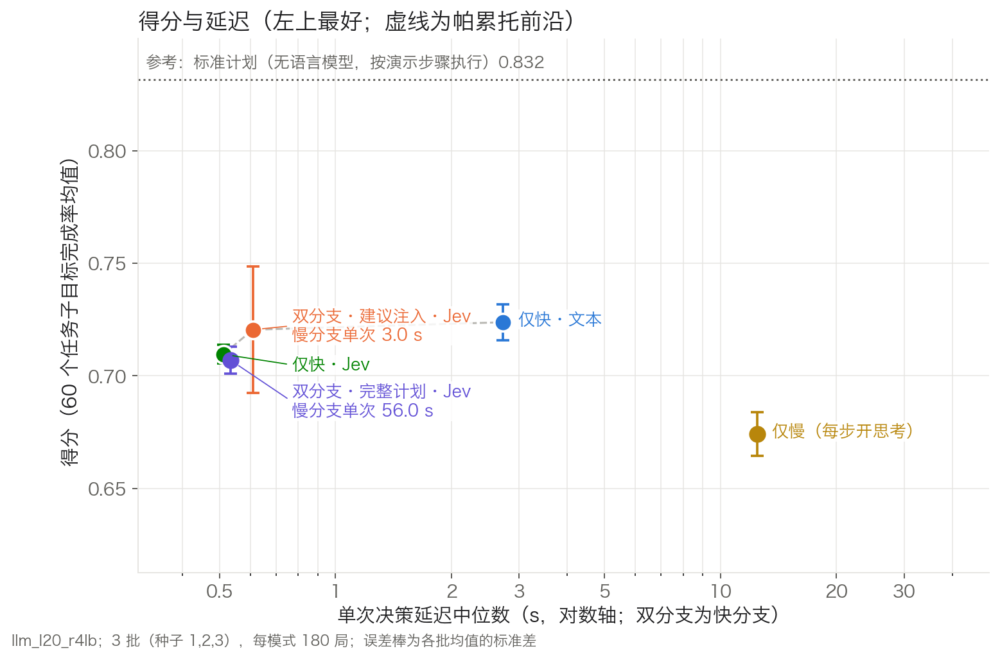
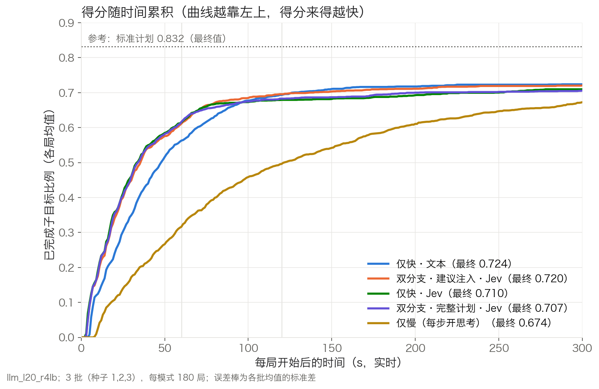
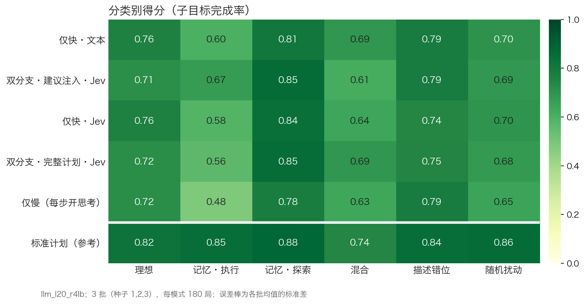

# RoboCerebra 实时快慢思考基准：阶段汇总（两条路线合并版）

整理日期：2026 年 10 月 22 日；10 月 25 日更新，补充分数差异的原因分析（4.7）、交互式排行榜（4.8）和组会后的下一阶段调整（6.1）。本文合并两份材料：

- 路线 A《RoboCerebra复现：实验结果与下一阶段方案》（飞书原文档，10 月 22 日版）；
- 路线 B 的实验记录与排行榜完整版。

路线 A 的数字、表格和限定说明均照原文档转录，原图见原文档。代码仓库：GitHub 私有仓库 `Vincent-Leon/robocerebra-realtime`。

## 0. 结论速览

1. **两条路线分工互补。**
   - 路线 A 用公开的视觉-语言-动作策略直接输出机械臂动作，回答"学习策略能否完成 RoboCerebra 的操作"。
   - 路线 B 让语言模型只做高层调度，动作由基于仿真真值的脚本技能执行器完成，回答"执行可靠时，实时快慢调度的收益与代价"。
   - 路线 B 属于路线 A 文档中所说的"明确标注的真值辅助技能基线"，其结果不代表视觉动作策略的泛化能力。
2. **路线 A：三套公开策略在 Ideal 10 个任务上都没有完成任何一个长任务。**
   - 完整任务 0/10，累计子目标 0–2/76；31 个抓取指令时窗中只有 1 个出现接触并抬升，而且不是新完成的抓取。
   - 同一 OFT 在原生 LIBERO 的 9 个开发回合全部成功，在 RoboCerebra 上从示范起点独立抓取，150 步和 600 步共四组都失败。
   - 由此判断：基本接入可用，问题在任务迁移和具体执行能力。
3. **两边的演示回放结果一致，差别只来自计分器。**
   - 在 Ideal case1–10 上，按官方计分做状态回放，两边都是 55/76，逐任务相同，完整任务 3/10。
   - 按路线 B 的修复版计分是 75/76，完整任务 9/10；40 个任务文件合计为 400/405，官方计分为 248/405。
4. **计分语义问题两边都已发现，需要统一处理。**
   - 路线 A：只把物体移到空中、机械臂不动，官方 Pick 也会从 0 变为 1。
   - 路线 B：官方子目标链要求复现演示的翻找顺序；60 个任务中有 10 个的评分目标引用了场景定义里没有的站点，对任何规划器都不可达。路线 B 对这两点都做了修复。
5. **路线 B：在 RoboCerebra 全部 60 个任务、5 种推理模式、3 批共 900 局上完成了实时排行榜。**
   - 给满 300 s 时，前四名得分 0.707–0.724，彼此不可区分。
   - 时间预算收紧到 60 s 后，以 Jev 为快分支的三种模式（0.611–0.617）显著高于仅快·文本（0.563）和每步开思考的仅慢（0.316）。
   - 完整计划模式的慢分支计划首个到达时间中位数为 40 s，实际执行的技能只有 4.1% 来自计划。
6. **下一步。**
   - 两边共同统一计分口径并核对场景版本；
   - 路线 A 按"独立技能 → 连续任务"推进；
   - 路线 B 解决"未完成即宣布完成"和"计划到达过晚"；
   - 路线 A 的技能通过门槛后，接入路线 B 的实时框架，用同一排行榜流程评测。

**10-25 补充**：当前设定下，限制得分的主要是决策速度和失败后的恢复（识别不可行动作、核实是否完成），而不是推理深度，详见 4.7。交互式排行榜见 4.8。

## 1. 研究目标与两条路线

总体目标：在 RoboCerebra（NeurIPS 2025 Datasets & Benchmarks）的长程操作任务上，研究实时条件下的快慢思考调度。最终方法是同一模型、共享前缀 KV 缓存的快慢双分支。

| | 路线 A：学习策略直接控制 | 路线 B：语言模型实时调度 |
|---|---|---|
| 决策者 | 公开视觉-语言-动作策略（OpenVLA-OFT、SmolVLA），直接输出 7 维动作 | Qwen3.8-27B（FP8，自部署 vLLM），选择下一个技能及参数 |
| 执行 | 策略动作经 Panda OSC_POSE 控制器执行，20 Hz | 15 个脚本技能（pick、place、open_drawer 等），基于仿真真值；抽屉开关等为抽象运动学技能 |
| 计时 | 推理期间暂停仿真 | 实时：仿真 1 s 等于墙钟 1 s，模型思考时场景继续运行 |
| 任务范围 | Ideal case1–10（单种子） | 全部 60 个任务（6 类 × 10），3 个种子 |
| 计分 | 作者原评分（官方） | 官方计分与修复版计分（v6）同时记录，主报告用修复版 |
| 当前状态 | 初评、示范回放与专项诊断完成；尚未开展训练与实时实验 | 执行器冻结，60 任务排行榜完成 |

## 2. 共用基础与已发现的问题

### 2.1 任务结构与运行条件

RoboCerebra 的 60 个任务分 6 类，每类 10 个。底层是 40 个任务文件：理想、描述错位、随机扰动三类共用同一批文件，只是运行条件不同。官方评测代码中各类的运行条件如下（路线 B 已实现，见 `exp/rc_dynamics.py`）：

| 类别 | 运行条件 |
|---|---|
| 理想（Ideal） | 无动态事件 |
| 记忆·执行（Memory_Execution） | 无动态事件，需要记住之前看到的物体位置 |
| 记忆·探索（Memory_Exploration） | 无动态事件，目标物体在抽屉或柜子里，需要翻找 |
| 随机扰动（Random_Disturbance） | 子步切换后把相关物体（50%）或无关物体沿 y 方向平移 ±0.15 m |
| 描述错位（Observation_Mismatching） | 开局状态取自人类演示第 2 个子步的开始时刻，第 1 个子步已完成但指令不变；这部分子目标不计分 |
| 混合（Mix） | 同时有随机扰动和描述错位 |

官方评测按固定时间片（150 步）切换子步，并在每段重置到演示状态。路线 B 是实时连续执行、完成即切换，因此做了两点适配：扰动在"当前子步"变化时触发，位移相对物体当前位置。

### 2.2 演示回放：两边一致，差别来自计分器

| Ideal 任务 | 目标数 | 状态回放（官方计分，A） | 状态回放（官方计分，B） | 状态回放（修复版计分，B） | 动作回放（官方计分，A） |
|---|---|---|---|---|---|
| case1 | 6 | 4 | 4 | 6 | 4 |
| case2 | 4 | 1 | 1 | 4 | 1 |
| case3 | 10 | 8 | 8 | 10 | 5 |
| case4 | 6 | 3 | 3 | 5 | 3 |
| case5 | 6 | 6 | 6 | 6 | 0 |
| case6 | 6 | 6 | 6 | 6 | 6 |
| case7 | 7 | 3 | 3 | 7 | 3 |
| case8 | 7 | 7 | 7 | 7 | 7 |
| case9 | 11 | 7 | 7 | 11 | 8 |
| case10 | 13 | 10 | 10 | 13 | 6 |
| 合计 | 76 | 55（完整 3/10） | 55（完整 3/10） | 75（完整 9/10） | 43（完整 2/10） |

- 两边独立实现的状态回放在官方计分下逐任务相同，说明回放流程本身一致。
- 演示本身都触发不了的子目标，任何策略都拿不到分。路线 B 逐条定位过这些子目标，主要原因是官方的判定规则，修复版计分针对这些规则做了修改（见 2.3 节）。全部 40 个任务文件的回放结果：官方计分 248/405（完整 6/40），修复版计分 400/405（完整 37/40）。
- 动作回放低于状态回放，case5 尤其明显（6/6 对 0/6），这与场景版本有关，见 2.4 节。

### 2.3 计分语义

路线 A 的受控干预：

| 受控干预 | 原 Pick 分数 | 夹爪抓取接触 | 机械臂关节变化 |
|---|---|---|---|
| 原始状态 | 0 | — | — |
| 只移动物体到空中，机械臂不动 | 1 | 无抓取接触 | 0.0 rad |

只修改物体状态、没有抓取接触，官方 Pick 却从 0 变为 1，说明该判据可以被区域变化触发，不能单独证明真实抓取。路线 A 建议：保留原评分，同时记录正确物体、双指接触、抬升高度、持续持物时间、容器内停留和释放状态。原评分与修订评分分别报告。

路线 B 的修复版计分（`exp/scoring.py`，规则 R1–R11）主要处理以下问题：
- **区域判定**：薄片站点（如 `*_side`）改为体积判定；桌面与容积型区域的高度容差；同一柜子各抽屉区域按高度就近归属。
- **pick**：物体须靠近末端，且抬升超过 4 cm 或离开所有受监控区域，并连续保持 ≥ 10 帧。按此定义，路线 A 的反例（机械臂不动）不会计入，但尚未用该探针实测。与路线 A 建议的"双指接触 + 抬升 + 持续持物"相比，该判据仍然偏宽。
- **放置类子目标（in / on）**：物体须已离手并连续保持 5 帧。
- **pour、open、close**：判据按演示校准。
- **探索前缀不计顺序（R11）**：官方子目标链要求复现演示者逐个翻找抽屉的顺序。智能体换一种同样合理的顺序就会卡在链的中间，其后已完成的子目标全部不计；例如某局任务实际已完成，只计 8/15。修复后，链首连续的开/关步骤各自独立计分，其余步骤仍按顺序推进。
- **不可达的评分目标**：60 个任务中有 10 个，评分目标引用了场景定义（BDDL）未声明的站点（7 个灶台 `cook_region`，3 个托盘 `contain_region`）。这些站点不在提供给规划器的区域列表中，整任务成功的上限为 0。路线 B 已把这些站点补进区域列表。

路线 B 在每局中同时记录官方计分与修复版计分，满足路线 A"原评分与修订评分分别报告"的要求。

### 2.4 场景与版本兼容（路线 A，case5）

| MuJoCo / robosuite | 场景来源 | 状态回放 | 动作回放 | 数据时间 |
|---|---|---|---|---|
| 2.3.7 / 1.4.1 | 当前生成 | 6/6 | 0/6 | 历史 |
| 3.2.7 / 1.4.0 | 当前生成 | 6/6 | 0/6 | 本次 |
| 3.2.7 / 1.4.0 | 记录 XML | 2/6 | 2/6 | 本次 |

- 单独更换版本后，结果仍是 6/6 与 0/6；同一版本换成记录 XML 后，两种回放均为 2/6。
- 快照确认桌面评分区域高度不一致：当前场景 z = 0.42 m，记录 XML 为 0.02 m。
- 结论：版本变化与记录场景都没有恢复完整示范，不能把动作失配直接归结为其中一个因素。

路线 B 使用当前生成场景（MuJoCo 3.1.6 / robosuite 1.4.1），只做状态回放与真值技能执行，因此不受动作回放失配影响。两边的版本不同（A 为 2.3.7 和 3.2.7，B 为 3.1.6），需要统一核对（见第 6 节）。

## 3. 路线 A：学习策略直接控制

本节转录自路线 A 原文档。历史模型数据为 10 月 17 日记录，新增诊断为 10 月 22 日记录。原图见原文档对应章节。

### 3.1 三套公开策略的初评

| 公开权重 | 回合数 | 累计子目标 | 合并比例 | 任务宏平均 | 完整任务 |
|---|---|---|---|---|---|
| Yun5 RoboCerebra OFT 4000 | 10 | 0 / 76 | 0% | 0% | 0 / 10 |
| LeRobot SmolVLA RoboCerebra | 10 | 2 / 76 | 2.63% | 1.54% | 0 / 10 |
| moojink LIBERO OFT 300000 | 10 | 2 / 76 | 2.63% | 3.33% | 0 / 10 |

**设置**
- 任务与输入：Ideal case1–case10，seed = 7，发布初态，正确的子任务文字。
- 控制：Panda 使用 OSC_POSE，20 Hz；推理期间暂停仿真。
- 时间片：初始静置 15 步计入时钟；首段只有 135 个策略动作，后续每段 150 步；不在边界恢复状态，保留已有动作队列。
- 策略加载：新 OFT 采用配套动作头与自身状态投影器，动作块为 8×7；三个策略分别使用各自的归一化与夹爪约定。加载与动作对应核查已通过，低分不能直接归因于权重未加载。

**口径说明**
- 2/76 是累计条件通过数，不能直接解释为稳定完成了两次正确抓取。
- SmolVLA 的两个计分项集中在 case10；moojink OFT 在 case1 与 case6 各计到一个。

### 3.2 抓取指令下机械臂实际做了什么

| 策略 | Pick 指令时窗 | 末端距目标 ≤ 5 cm | 检测到目标双指接触 | 接触并抬升持续 3 s |
|---|---|---|---|---|
| Yun5 OFT 4000 | 31 | 0 | 0 | 0 |
| SmolVLA RoboCerebra | 31 | 0 | 0 | 0 |
| moojink OFT 300000 | 31 | 1 | 1 | 1 |

- 唯一的阳性时窗不是一次新完成的抓取：case1 要求先抓奶油奶酪，moojink 在第 35 步就已接触黄油；第 585 步切到"抓黄油"时，黄油早已在手中。
- 首条指令内，三个策略离奶油奶酪的最近距离分别为 22.5、24.4、22.5 cm。
- 后三列是辅助诊断，不能替代原任务计分。

### 3.3 case1 的目标选择偏差

| 物体 | 整回合最大位移 | 最大高度变化 | 最近末端距离 |
|---|---|---|---|
| 奶油奶酪（首条指令目标） | 0.0000 m | 0.0000 m | 0.225 m |
| 黄油（后续步骤涉及物体） | 0.761 m | 0.521 m | 0.020 m |

首条指令要求拿奶油奶酪，但整回合奶油奶酪几乎不动，黄油位移明显。该现象支持"目标选择或任务迁移"问题，仅延长动作预算无法保证选对物体。

### 3.4 OFT 放回原生 LIBERO 任务

| 预先指定任务 | 原生目标成功数 | 三个初态的实际策略步数 |
|---|---|---|
| Spatial 0：碗位于盘与小碗之间 | 3 / 3 | 79、80、82 |
| Spatial 1：碗位于小碗旁边 | 3 / 3 | 101、98、110 |
| Spatial 2：碗位于桌面中央 | 3 / 3 | 94、90、97 |

- 设置：同一 OFT 300000，双图与 8 维自身状态，8 步动作块，`libero_spatial_no_noops` 统计量。每任务取发布初态索引 0、1、2，seed = 0，等待 10 步后最多 220 个策略动作。
- 9/9 说明模型与基本动作链可用，减弱了"权重或通用动作转换整体失效"的解释。
- 任务少且来自训练域，不能推断 LIBERO 总体成功率或 RoboCerebra 迁移能力。

### 3.5 独立抓取与动作预算对照

| 独立技能 | 预算 | 原评分 | 实际步数 | 最近末端距离 | 最大抬升 |
|---|---|---|---|---|---|
| case6 抓取黄油 | 150 | 0 / 1 | 150 | 0.121 m | 0.24 mm |
| case6 抓取黄油 | 600 | 0 / 1 | 600 | 0.121 m | 0.24 mm |
| case8 抓取奶油奶酪 | 150 | 0 / 1 | 150 | 0.596 m | 0.00 mm |
| case8 抓取奶油奶酪 | 600 | 0 / 1 | 600 | 0.596 m | 0.00 mm |

- 设置：每次从对应抓取示范的起点独立开始（特权示范初态），正确指令，seed = 7，同一 OFT 与夹爪转换。选 case6 与 case8，是因为这两个任务的两类示范回放均通过。
- 结果：四组都没有进入稳定抓取阶段；从 150 步加到 600 步，最近距离与抬升都没有改善。
- 这是独立技能诊断，不累加到历史成绩，也不代表连续长任务能力。

### 3.6 低成功率的分层定位

| 问题层 | 已有证据 | 当前判断与验证方向 |
|---|---|---|
| 执行策略与目标选择 | case1 奶油奶酪几乎不动、黄油明显位移 | 实际存在行为失败；结合原生任务与独立技能区分接入和迁移 |
| 场景与动作兼容 | case5 换兼容栈仍为 6/6 与 0/6，记录 XML 均为 2/6 | 版本和原 XML 都不能单独修复；继续核对控制状态与轨迹 |
| 切换时机与误差累积 | 67/76 个示范段长于默认可用预算；未成功也定时切换 | 预算和前置条件是合理假设，但不能由示范时长直接推出模型必需时间 |
| 评分语义 | Pick 区域变化不直接验证稳定抓取 | 原分数与物理技能质量应同时保存，不能靠放松评分制造改善 |
| 论文协议与权重 | 第三方权重，未实现完整语义匹配与 resume | 当前是公开策略初评，尚未复现论文数值 |
| 统计与实时性 | 每任务仅 1 次，推理时暂停 | 暂不能排序模型，也不能讨论真实时间压力下的快慢收益 |

已做的夹爪、裁剪、动作块和动作倍率对照没有恢复稳定能力，后续不再做无目的的扫描。原文档强调把"证据存在"与"根因已证明"分开表述。

## 4. 路线 B：语言模型实时调度

### 4.1 设置

- **模型**：Qwen3.8-27B，FP8，L20 单卡，vLLM 0.27.1，开启前缀缓存。所有模式用同一模型、同一服务实例。
- **执行**：
  - 实时运行，仿真 1 s 等于墙钟 1 s，控制频率 20 Hz；
  - 每局上限 300 s、40 次技能调用；
  - 语言模型只决定下一个技能及参数，执行器在整个排行榜期间冻结。
- **实时性判据**：开局 3 s 后最大滞后 ≤ 0.25 s，且滞后 p95 ≤ 50 ms。900 局全部满足；运行中有 9 局因系统卡顿不合格，已在同一代码快照上重跑。
- **执行器能力（标准计划参考）**：不用语言模型，按演示的子步顺序逐步调用技能，60 个任务的子目标完成率均值为 0.832，24/60 个任务可整体完成。已知限制对所有模式相同：
  - 微波炉门和炉内放取未实现（约 16–20 个子目标）；
  - 距底座 0.88–0.92 m 的物体够不到；
  - 平底锅放上灶台不稳定；
  - 部分倒入动作和杯子挂架不稳定。

**五种推理模式**

| 模式 | 做法 |
|---|---|
| 仅快·文本 | 关闭思考，每次决策直接生成一个 JSON 动作 |
| 仅快·Jev | 把当前所有合法的下一步动作列成带字母的候选项，模型只生成 1 个 token（选项字母），取对数概率最高者 |
| 仅慢（每步开思考） | 每次决策先思考（上限 4096 token）再输出动作 |
| 双分支·完整计划·Jev | 快分支（Jev）持续决策；慢分支在后台开思考，输出整段计划，快分支按计划执行 |
| 双分支·建议注入·Jev | 慢分支关闭思考，只输出不超过 2 句的建议，注入快分支上下文；在开局、技能失败、检测到循环、收到新消息时触发 |

两个双分支模式的快、慢分支共用同一个模型和同一段提示前缀，共享前缀的 KV 缓存。

### 4.2 排行榜（60 个任务 × 3 批，共 900 局）

| # | 模式 | 得分（± 批间标准差） | 整任务成功 | 单次决策 p50 / p95 | 慢分支单次 | 每任务用时 | 每任务 token（非缓存输入 + 输出） | 每任务 GPU 时间 |
|---|---|---|---|---|---|---|---|---|
| 1 | 仅快·文本 | 0.724 ± 0.008 | 35% | 2.73 / 4.08 s | – | 148 s | 15.2 k | 53 s |
| 2 | 双分支·建议注入·Jev | 0.720 ± 0.028 | 42% | 0.61 / 0.88 s | 3.0 s | 97 s | 26.3 k | 42 s |
| 3 | 仅快·Jev | 0.710 ± 0.004 | 37% | 0.51 / 0.68 s | – | 135 s | 22.8 k | 14 s |
| 4 | 双分支·完整计划·Jev | 0.707 ± 0.006 | 38% | 0.53 / 0.72 s | 56.0 s | 126 s | 26.0 k | 83 s |
| 5 | 仅慢（每步开思考） | 0.674 ± 0.010 | 34% | 12.46 / 55.26 s | – | 300 s | 11.0 k | 194 s |
| – | 参考：标准计划（无语言模型） | 0.832 | 40% | – | – | – | – | – |

各列定义如下：
- **得分**：每个任务的子目标完成率（修复版计分），60 个任务取平均。描述错位类开局已完成的子目标从分子分母同时扣除。
- **±**：3 批各自均值之间的标准差。
- **每任务用时、token、GPU 时间**：均为每局数值的中位数。token 只算非缓存输入加输出，与 VISTA 排行榜口径相同。

图 1 的读法：横轴是单次决策延迟中位数（对数轴），纵轴是全程得分，越靠左上越好。误差棒为批间标准差，虚线连接帕累托前沿。

### 4.3 时间预算与配对比较

| 模式 | 30 s | 60 s | 120 s | 180 s | 全程 |
|---|---|---|---|---|---|
| 仅快·文本 | 0.350 | 0.563 | 0.693 | 0.716 | 0.724 |
| 双分支·建议注入·Jev | 0.449 | 0.611 | 0.696 | 0.710 | 0.720 |
| 仅快·Jev | 0.461 | 0.615 | 0.679 | 0.688 | 0.710 |
| 双分支·完整计划·Jev | 0.460 | 0.617 | 0.683 | 0.694 | 0.707 |
| 仅慢（每步开思考） | 0.172 | 0.316 | 0.496 | 0.586 | 0.674 |

表中数值为每局前 B 秒内完成的子目标比例，口径与主表相同。

图 2 的读法：每条曲线是一种模式在开局后各时刻已完成的子目标比例（180 局均值），越靠左上得分来得越早。

**与仅快·Jev 的逐任务配对比较**：先把每个任务 3 批的得分取平均，再对同一任务计算得分差；95% 区间按任务重抽样（bootstrap，10000 次）。

| 模式 | 得分差（全程） | 95% 区间 | 得分差（60 s） | 95% 区间 |
|---|---|---|---|---|
| 仅快·文本 | +0.014 | [−0.030, +0.057] | −0.052 | [−0.088, −0.017] |
| 双分支·建议注入·Jev | +0.011 | [−0.036, +0.054] | −0.004 | [−0.037, +0.027] |
| 双分支·完整计划·Jev | −0.003 | [−0.035, +0.028] | +0.002 | [−0.018, +0.022] |
| 仅慢（每步开思考） | −0.035 | [−0.088, +0.015] | −0.299 | [−0.354, −0.245] |

### 4.4 分类别得分

图 3：每格为该模式在该类 10 个任务、3 批共 30 局上的平均得分，末行为标准计划参考。与参考差距最大的是两类：
- 记忆·执行：0.48–0.67，参考值 0.85；
- 随机扰动：0.65–0.70，参考值 0.86。

记忆·探索为 0.78–0.85，接近参考值 0.88。

### 4.5 主要结论

1. **全程得分上，前四名不可区分。**
   - 与仅快·Jev 的配对差在 −0.003 到 +0.014 之间，95% 区间都包含 0。
   - 仅慢为 0.674，配对差 −0.035，区间 [−0.088, +0.015]，也不显著。
2. **时间预算收紧后差异显著。**
   - 60 s 时，三种 Jev 快分支模式为 0.611–0.617，显著高于仅快·文本（−0.052）和仅慢（−0.299）。
   - 仅快·文本到 120 s 左右追平。
3. **每步开思考在实时设定下因时间耗尽而失分。**
   - 单次决策中位数 12.5 s，每局中位数只做 8 次决策。
   - 180 局中 122 局用满 300 s；这些局平均得分 0.52，标准计划在相同任务上为 0.77。
4. **完整计划与仅快·Jev 在各时间预算下都无差别：慢分支的计划基本没有派上用场。**
   - 慢分支每次 56 s，每局平均 1.7 次。
   - 180 局中只有 115 局收到过计划，首个计划在开局后中位数 40 s 才到达，此时快分支已完成约 0.55 的子目标。
   - 实际执行的技能中只有 4.1% 来自计划。
5. **建议注入与仅快·Jev 相比，全程得分没有显著提升，但其他指标更好。**
   - 整任务成功 76/180 vs 66/180；
   - 每任务用时 97 s vs 135 s；
   - 失败技能中位数 8.5 vs 16。

   问题是"未完成即宣布完成"较多（31/180，其中 18 局低于标准计划），批间波动也最大（0.703 / 0.753 / 0.705）。
6. **Token。** Jev 系列每局非缓存 token 更多（22.8–26.3 k，仅快·文本 15.2 k），原因有两点：
   - 候选列表让提示更长，约 2,000 token；
   - 双分支另有慢分支调用。

   快分支提示的缓存命中率为 49–59%。vLLM 对该混合架构模型以 784 token 为一块缓存，只有整块对齐的公共前缀能复用。

### 4.6 前期实验要点（第三轮，12 个试点任务）

- **长任务 case5（14 个子目标）**，各模式子目标完成率 / 用时 / 失败技能数：

  | 模式 | 完成率 | 用时 | 失败技能数 |
  |---|---|---|---|
  | 双分支·建议注入·Jev | 0.87 | 102 s | 2.6 |
  | 双分支·完整计划·Jev | 0.81 | 183 s | 18.2 |
  | 仅快·Jev | 0.79 | 183 s | 10.0 |
  | 建议注入（禁缓存） | 0.73 | 205 s | 15.4 |

  这是当时唯一能区分方法的任务。
- **前缀缓存**：实测 3,551 token 提示未命中 1.61 s、命中 0.26 s。请求级 `cache_salt` 可使命中归零，且不影响其他请求，此后禁缓存对照都改用这种方式。
- **执行器修正**：腕部偏航角折叠、抽屉内容物随抽屉移动等。12 个试点任务的标准计划从 95/129 提升到 116/129。修正中还发现，此前一个 12/12 的结果是伪成功：物体被弹出抽屉后在桌面上完成。

### 4.7 分数差异的原因（10-25 补充）

1. **全程得分趋同，主要受执行器能力限制。**
   - 约一半任务五种模式得分完全相同：执行器能做到的子目标各模式都做到了，做不到的（微波炉、超出可达范围的物体等）各模式都做不到。
   - 快模式一局中位数 97–148 s 即结束，300 s 的预算并不紧张。
2. **时间预算拉开差距，原因是决策延迟累积。**
   - 快分支模式下，机械臂每完成一个技能就等待下一条指令，一局用时约等于技能执行时间加上累计决策时间。
   - 单次决策 Jev 0.5 s、文本 2.7 s、仅慢 12.5 s，得分曲线依次右移。仅慢每局中位数只做 8 次决策，180 局中 122 局到 300 s 仍未完成。
3. **慢分支的价值取决于时效。**
   - 完整计划：首个计划中位数 40 s 才到，只有 4.1% 的技能来自计划。
   - 建议注入：3 s 一次，在失败与循环时触发，失败技能约减半，整任务成功最多；但 31/180 局未完成即宣布完成，抵消了均分上的收益。
4. **分类别差距主要来自失败后的处理，而不是"记忆"本身。**
   - 随机扰动：同一批任务从理想到随机扰动，各模式下降 0.03–0.07。
     - 仅快·Jev 的失败技能中位数从 12 增至 26，用尽 40 次技能的局从 6 增至 11。
     - 失败主要是物体被移出可达范围（距底座 0.89 m，超过 0.87 m），或变得难以抓取后反复重试。
     - 扰动后 10 s 内的失败率并不更高，所以不是"按旧观测下指令"造成的。
     - 建议注入的失败增幅最小（10 → 14）。
   - 记忆·执行：
     - case5 中所有模式拿起巧克力布丁后，放到盘子上反复"搬运失败"直至超时，而标准计划可 7/7 完成，属于执行器在该状态下的问题；
     - case6、7 卡在微波炉，标准计划同样无法完成；
     - 末三分之一子目标完成率只有 0.41（前两段约 0.7）。
5. **结论：** 当前设定下，限制得分的主要是决策速度和失败后的恢复（识别不可行动作、核实是否完成），而不是推理深度。

### 4.8 交互式排行榜

排行榜静态网页 `notes/leaderboard/index.html`：单文件，离线可用。
- 顶部可切换时间预算（30 / 60 / 120 / 180 秒、全程），排名、得分条、与仅快·Jev 的配对比较（显著性）、散点图和分类别热力图会随之重新计算。
- 每张图都可以切换为数据表。
- 所有数字都由 900 局的逐局记录在页面内计算；生成脚本为 `exp/make_leaderboard_page.py`。

## 5. 两条路线的对接

1. **路线 A 原文档第十节列出了实时快慢实验需要固定的比较条件，路线 B 已实现其中大部分。**
   - 同一执行器版本和相同的任务初态与事件配置；
   - 同一模型实例；
   - 仿真按墙钟推进，记录逐局时间线与滞后 p50 / p95，并预先固定实时性判废条件；
   - 用请求级 `cache_salt` 隔离缓存，已验证所用服务支持；
   - 同初态配对比较，报告配对差与区间；
   - 原评分与修订评分并列记录。
2. **尚未覆盖或需要核对的部分：**
   - "串行快慢"和"并行不共享前缀"两种方法还没进入排行榜；
   - 固定延迟干预与目标变更事件只在试点任务上做过；
   - 回合结束时尚未返回的慢分支请求是否全部计入等待代价，需要核对。
3. **执行器的接口。** 路线 B 的规划器通过技能接口调用执行器（如 `pick(obj)`、`place(region)`、`open_drawer(region)`）。路线 A 的学习技能通过其 P1 门槛后（每技能至少 9/10、正确物体持续持有 3 s），可以替换对应的脚本技能，在同一实时框架和排行榜流程下评测。这样能分开回答两个问题：高层调度的收益，以及执行能力对这一收益的影响。
4. **计分口径**：两边统一为"官方计分 + 修订计分并列报告"。修订计分的正反例测试，应包含路线 A 的 Pick 反例和路线 B 的探索顺序、不可达目标案例。

## 6. 下一阶段计划（合并）

| 编号 | 工作 | 负责 | 产出 / 进入下一步的条件 |
|---|---|---|---|
| 共 1 | 计分口径统一：建立正反例测试集（含 Pick 反例、探索顺序、不可达目标），官方与修订计分逐任务对照 | A + B | 正反例全部按预期判定；两种计分的逐任务对照表 |
| 共 2 | 场景与版本核对：case5 计分区域高度差（0.42 vs 0.02 m）是否影响其他任务；统一 MuJoCo / robosuite 版本与场景来源 | A + B | 版本清单与受影响任务列表 |
| A1 | 独立技能：先取与放，再扩展开柜与倾倒；验证接触、抬升、持物、释放 | A | 每技能至少 9/10，正确物体持续持有 3 s（预注册门槛，报告成功数与区间） |
| A2 | 连续任务：按完成或明确失败推进技能，有限重试与恢复 | A | 5 个开发任务 × 3 种子；控制失败率与长任务成功率分开报告 |
| B1 | 完成判定核实：减少"未完成即宣布完成"（建议注入 31/180，仅快·文本 40/180） | B | 宣布完成的准确率；全程与 60 s 得分 |
| B2 | 完整计划提前到达：限制思考长度，或先输出前几步再补全 | B | 首个计划到达时间；来自计划的技能占比 |
| B3 | 排行榜：固定同时报告全程与时间预算得分；补微波炉技能；加入串行快慢、并行不共享前缀两种方法 | B | 新版排行榜 |
| 对接 | A1 达标的学习技能按技能接口接入实时框架，用同一排行榜流程评测 | A + B | 学习策略执行下的排行榜，与真值技能执行对照 |

原则（沿用路线 A）：
- 计划中的门槛不是已获得的结果；
- 通过门槛后冻结代码，再用预留初态验证，避免按表现挑选测试任务；
- 不以扩大种子或更换模型代替根因验证。

### 6.1 10-25 组会后的调整

- **平台**：仿真与评测从本机迁到 H20 服务器（Linux 无界面渲染、多局并行，逐局保留实时性判据），不再受本机 2 局并行的限制。
- **模型扩展**：
  - OpenAI GPT-6 Luna：快档，可配 GPT-6 Sol 做慢分支，测"快模型 + 强模型"的异构组合；
  - DeepSeek V4.1 Flash：本地 4×H20 部署版与官方 API 对照，排查量化带来的差异；
  - 实验室网关上更大的 Qwen，如 sal-max。

  正式评测前，先确认各模型能否关闭思考、是否返回 logprobs（Jev 依赖）、前缀缓存是否可用。
- **方法改进**：同一动作连续失败 2 次后从候选中移除；宣布完成前先核实。在新版本下重跑 Qwen3.8-27B 基线，排行榜同时报告全程与 60 秒得分。
- **待定**：OpenAI API Key 与预算。

## 7. 代码与数据

- **代码仓库**：GitHub 私有仓库 `Vincent-Leon/robocerebra-realtime`。
  - `exp/`：路线 B 代码，包括环境与动态条件、技能执行器、计分器、实时异步环境、规划器与排行榜统计。
  - `notes/`：实验记录与报告。
  - `server/`：模型服务部署脚本。
  - `vla_policy_eval/`：路线 A 代码，待推送。
- **路线 B 原始数据**：每局 `episode.json`、`timeline.json`、`states.npz`，在本地 `exp/runs/llm_l20_r4lb/`，体积较大不入库。统计脚本 `exp/analyze_leaderboard.py` 与 `exp/plot_leaderboard.py` 可从原始数据复现本文全部数字和图。
- **路线 A 原始数据**：原文档附录列出的 `outputs/17_ideal_pilot`、`outputs/25_oft_release_20261016T230450Z`、`outputs/34_executor_validation_20261022_v3`、`outputs/35_scoring_semantics_20261022`、`outputs/39_scene_compatibility_20261022` 等，以及 `scripts/33_native_libero_probe.py`、`scripts/34_executor_validation_batch.py`、`scripts/35_scoring_semantics_probe.py`。
- **排行榜网页与组会材料**：`notes/leaderboard/index.html`（交互式排行榜，生成脚本 `exp/make_leaderboard_page.py`）；10-25 组会 PPT `notes/组会_2026-10-25_本周进展.pptx`（生成脚本 `exp/make_group_deck_1025.js`）。
- **新 OFT 来源**：`moojink/openvla-7b-oft-finetuned-libero-spatial-object-goal-10`，revision `638918f3d1c2e43a39a8a20772bdb8b91835e4b7`。

## 附录：术语

| 术语 | 含义 |
|---|---|
| 子目标完成率 | 一个任务中完成的子目标数 / 子目标总数；RoboCerebra 按每个物体的状态序列逐步计分 |
| 整任务成功 | 全部子目标都完成 |
| 官方计分 / 修复版计分 | RoboCerebra 作者的原评分 / 路线 B 的修订评分（v6，规则 R1–R11），两者同时记录 |
| 状态回放 / 动作回放 | 把演示的仿真状态逐帧写回 / 把演示的动作序列重新执行，用于检验计分与场景兼容 |
| 标准计划 | 不用语言模型，按演示的子步顺序调用技能，是执行器能力的近似上限 |
| Jev | 把候选动作列成选项，模型只输出 1 个选项字母，用对数概率选择 |
| 实时性判据 | 开局 3 s 后最大滞后 ≤ 0.25 s 且滞后 p95 ≤ 50 ms，不满足的局作废重跑 |
| 时间预算得分 | 开局后前 B 秒内完成的子目标比例 |
| 帕累托前沿 | 没有其他模式比它更快且得分更高的模式集合 |
| 配对比较 | 同一任务上两种模式的得分差，按任务重抽样给出 95% 区间 |
