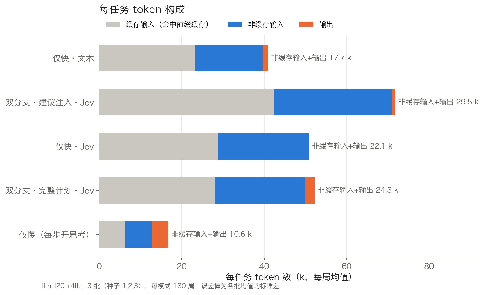
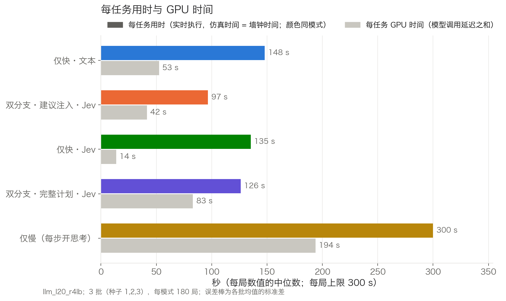

# RoboCerebra 60 任务排行榜：完整版（3 批，2026-10-22）

格式参考 VISTA（https://vista-benchmark.org/ ）：每行是一种推理模式，列为得分（± 批间标准差）、整任务成功率、延迟、每任务用时、token 与 GPU 时间。共 3 批（种子 1、2、3），每批 5 种模式 × 60 个任务，合计 900 局，全部满足实时性判据。第一版（只有第 1 批）见 `排行榜_第一版_2026-10-22.md`。

## 1. 实验设置

- **模型**：Qwen3.8-27B，FP8 量化，L20 单卡，vLLM 0.27.1，开启前缀缓存。所有模式用同一个模型、同一个服务实例。
- **任务**：RoboCerebra 全部 60 个任务，分 6 类，每类 10 个。底层是 40 个任务文件，理想、描述错位、随机扰动三类共用同一批文件，只是运行条件不同。

  | 类别 | 运行条件 |
  |---|---|
  | 理想（Ideal） | 无动态事件 |
  | 记忆·执行（Memory_Execution） | 无动态事件，任务需要记住之前看到的物体位置 |
  | 记忆·探索（Memory_Exploration） | 无动态事件，目标物体在抽屉或柜子里，需要翻找 |
  | 随机扰动（Random_Disturbance） | 每进入一个新子步 0.5 s 后，把当前子步的相关物体（50%）或一个无关物体沿 y 方向平移 ±0.15 m |
  | 描述错位（Observation_Mismatching） | 开局状态取自人类演示第 2 个子步的开始时刻。第 1 个子步已经完成，但指令不变，模型需要自己发现；这部分子目标不计分 |
  | 混合（Mix） | 同时有随机扰动和描述错位 |

  动态条件按官方评测代码实现。我们是实时连续执行、做完一步就切换，官方则按固定时间片切换并逐段重置，因此有两点适配：扰动在当前子步变化时触发，位移相对物体当前位置。
- **执行**：
  - 实时运行，仿真 1 s 等于墙钟 1 s，控制频率 20 Hz。模型思考期间机器人和场景不会暂停。
  - 每局上限 300 s、40 次技能调用。
  - 语言模型只决定下一步调用哪个技能（共 15 个，如 pick、place、open_drawer）以及参数，动作由技能库执行。执行器在整个排行榜期间冻结（`exp_r4snap/`）。
- **实时性判据**：开局 3 s 之后最大滞后 ≤ 0.25 s，且滞后 p95 ≤ 50 ms。
  - 第 1 批在夜间运行，没有不合格；第 2、3 批共 9 局不合格，发生在 10-22 06:38–19:01 之间。多为两个并行局同时卡顿 0.4–1.6 s，属于系统层面的停顿。
  - 这 9 局已在同一代码快照上重跑，原记录留档在 `exp/runs/llm_l20_r4lb_rtviolations/`。

### 五种模式

| 模式 | 做法 |
|---|---|
| 仅快·文本 | 关闭思考，每次决策直接生成一个 JSON 动作，如 `{"skill": "pick", "args": ["bowl_1"]}` |
| 仅快·Jev | 把当前所有合法的下一步动作列成带字母的候选项，模型只生成 1 个 token（选项字母），取对数概率最高者 |
| 仅慢（每步开思考） | 每次决策都先思考（上限 4096 token），再输出动作 |
| 双分支·完整计划·Jev | 快分支（Jev）不停做决策。慢分支在后台开思考，输出整段计划，快分支按计划执行；计划失效时慢分支重新规划 |
| 双分支·建议注入·Jev | 慢分支关闭思考，只输出不超过 2 句的建议，注入快分支上下文。在开局、技能失败、检测到循环、收到新消息时触发 |

两个双分支模式的快、慢分支共用同一个模型和同一段提示前缀，可以共享前缀的 KV 缓存。

## 2. 排行榜

| # | 模式 | 得分 | 整任务成功 | 单次决策 p50 / p95 | 慢分支单次 | 每任务用时 | 每任务 token（非缓存输入+输出） | 缓存输入 | 每任务 GPU 时间 | 失败技能 |
|---|---|---|---|---|---|---|---|---|---|---|
| 1 | 仅快·文本 | 0.724 ± 0.008 | 35%（63/180） | 2.73 / 4.08 s | – | 148 s | 15.2 k | 14.5 k | 53 s | 6 |
| 2 | 双分支·建议注入·Jev | 0.720 ± 0.028 | 42%（76/180） | 0.61 / 0.88 s | 3.0 s | 97 s | 26.3 k | 28.6 k | 42 s | 8 |
| 3 | 仅快·Jev | 0.710 ± 0.004 | 37%（66/180） | 0.51 / 0.68 s | – | 135 s | 22.8 k | 31.4 k | 14 s | 16 |
| 4 | 双分支·完整计划·Jev | 0.707 ± 0.006 | 38%（68/180） | 0.53 / 0.72 s | 56.0 s | 126 s | 26.0 k | 25.1 k | 83 s | 16 |
| 5 | 仅慢（每步开思考） | 0.674 ± 0.010 | 34%（61/180） | 12.46 / 55.26 s | – | 300 s | 11.0 k | 5.5 k | 194 s | 2 |
| – | 参考：标准计划（无语言模型，按演示步骤执行） | 0.832 | 40%（24/60） | – | – | – | – | – | – | – |

排名只按得分均值。前四名之间的差异不显著，见第 4 节。

各批得分（种子 1 / 2 / 3）：

| 模式 | 种子 1 | 种子 2 | 种子 3 |
|---|---|---|---|
| 仅快·文本 | 0.733 | 0.719 | 0.719 |
| 双分支·建议注入·Jev | 0.703 | 0.753 | 0.705 |
| 仅快·Jev | 0.709 | 0.714 | 0.706 |
| 双分支·完整计划·Jev | 0.700 | 0.709 | 0.712 |
| 仅慢（每步开思考） | 0.685 | 0.667 | 0.670 |

**各列含义**
- **得分**：每个任务的子目标完成率，60 个任务取平均；表中为 3 批 180 局的均值。
  - 子目标来自 RoboCerebra 的评分定义，按计分器 v6 计算。
  - 描述错位和混合类任务中，开局已完成的子目标同时从分子和分母扣除。
  - 失败或超时的局按实际完成的子目标计分。
- **±**：3 批各自 60 任务均值之间的标准差，口径与 VISTA 相同。
- **整任务成功**：全部子目标都完成的局数占比。
- **单次决策 p50 / p95**：每次调用模型做决策的延迟（中位数 / 95 分位）。双分支模式取快分支，仅慢模式取每步开思考的调用。
- **慢分支单次**：双分支模式慢分支每次调用的延迟中位数。
- **每任务用时**：一局的时长（中位数）。全部完成、模型宣布完成、40 次技能用尽或 300 s 到时，最先发生者结束一局。
- **每任务 token**：与 VISTA 口径相同，为非缓存输入加输出，取每局中位数；缓存输入单独列出。
- **每任务 GPU 时间**：一局内所有模型调用的延迟之和（中位数）。模型是自部署的，用它代替 VISTA 的"成本"列。
- **失败技能**：一局内技能返回失败的次数（中位数），如抓取未成功、被上层抽屉挡住、抽屉未打开。不含格式无效的回复。
- **参考行**：用同一个执行器，按人类演示的子步顺序逐步调用技能，不使用语言模型，可以看作执行器能力的近似上限。它不是严格上限：标准计划不重试、不换目标位置，而每种模式都有 7–11 个任务的 3 批平均得分高于它。

## 3. 不同时间预算下的得分

实时设定下，得分来得早晚本身就是延迟代价的体现。下表是每局前 B 秒内完成的子目标比例，口径与主表相同；"全程"即主表得分。

| 模式 | 30 s | 60 s | 120 s | 180 s | 全程 |
|---|---|---|---|---|---|
| 仅快·文本 | 0.350 | 0.563 | 0.693 | 0.716 | 0.724 |
| 双分支·建议注入·Jev | 0.449 | 0.611 | 0.696 | 0.710 | 0.720 |
| 仅快·Jev | 0.461 | 0.615 | 0.679 | 0.688 | 0.710 |
| 双分支·完整计划·Jev | 0.460 | 0.617 | 0.683 | 0.694 | 0.707 |
| 仅慢（每步开思考） | 0.172 | 0.316 | 0.496 | 0.586 | 0.674 |

**怎么读**：
- 横轴是一局开始后的时间，纵轴是到该时刻为止完成的子目标比例（180 局均值）。
- 曲线越靠左上，得分来得越早；曲线末端即主表得分。
- 点线是标准计划参考的最终值。

## 4. 与仅快·Jev 的逐任务配对比较

双分支模式用的就是 Jev 快分支，所以以仅快·Jev 为基线。计算方法：
- 先把每个任务 3 批的得分取平均；
- 在同一任务上计算两种模式的得分差，再对 60 个任务取平均；
- 95% 区间是按任务重抽样（bootstrap，10000 次）得到的；区间包含 0，表示差异不显著。

左半为全程得分，右半为 60 s 时间预算下的得分。

| 模式 | 得分差（全程） | 95% 区间 | 更好 / 相同 / 更差 | 得分差（60 s） | 95% 区间 | 更好 / 相同 / 更差 |
|---|---|---|---|---|---|---|
| 仅快·文本 | +0.014 | [−0.030, +0.057] | 20 / 22 / 18 | **−0.052** | **[−0.088, −0.017]** | 14 / 15 / 31 |
| 双分支·建议注入·Jev | +0.011 | [−0.036, +0.054] | 24 / 23 / 13 | −0.004 | [−0.037, +0.027] | 17 / 27 / 16 |
| 双分支·完整计划·Jev | −0.003 | [−0.035, +0.028] | 13 / 30 / 17 | +0.002 | [−0.018, +0.022] | 13 / 34 / 13 |
| 仅慢（每步开思考） | −0.035 | [−0.088, +0.015] | 16 / 20 / 24 | **−0.299** | **[−0.354, −0.245]** | 1 / 9 / 50 |

粗体为显著差异。

## 5. 分类别得分

**怎么读**：每格是该模式在该类 10 个任务、3 批共 30 局上的平均得分，末行为标准计划参考。

| 模式 | 理想 | 记忆·执行 | 记忆·探索 | 混合 | 描述错位 | 随机扰动 |
|---|---|---|---|---|---|---|
| 仅快·文本 | 0.759 | 0.600 | 0.806 | 0.689 | 0.788 | 0.702 |
| 双分支·建议注入·Jev | 0.713 | 0.670 | 0.853 | 0.613 | 0.788 | 0.686 |
| 仅快·Jev | 0.764 | 0.580 | 0.837 | 0.639 | 0.741 | 0.697 |
| 双分支·完整计划·Jev | 0.717 | 0.562 | 0.848 | 0.688 | 0.748 | 0.679 |
| 仅慢（每步开思考） | 0.716 | 0.484 | 0.779 | 0.634 | 0.787 | 0.645 |
| 标准计划（参考） | 0.823 | 0.847 | 0.875 | 0.744 | 0.844 | 0.855 |

## 6. 结束原因

| 模式 | 全部完成 | 宣布完成（未全部完成） | 40 次技能用尽 | 300 s 到时 |
|---|---|---|---|---|
| 仅快·文本 | 63 | 40 | 41 | 36 |
| 双分支·建议注入·Jev | 76 | 31 | 46 | 27 |
| 仅快·Jev | 66 | 12 | 67 | 35 |
| 双分支·完整计划·Jev | 68 | 17 | 54 | 41 |
| 仅慢（每步开思考） | 58 | 0 | 0 | 122 |

- "宣布完成"有两种情况：快分支连续两次判定任务已完成，或完整计划执行完毕。这一列只统计宣布时还有子目标没有完成的局。
- 所有模式都没有出现连续 5 次无效回复而中止的情况。
- 仅慢模式有 3 局在接近或刚过 300 s 时（298.9–303.4 s）才完成最后一个子目标，没有记录"全部完成"事件。这 3 局在主表里计为整任务成功（61 局），在本表中计入"300 s 到时"。

## 7. 其他图

### 得分与单次决策延迟

**怎么读**：
- 横轴是单次决策延迟中位数（对数轴），纵轴是全程得分，越靠左上越好。
- 误差棒是 3 批之间的标准差。
- 虚线连接帕累托前沿上的模式，即没有别的模式比它更快且得分更高。
- 双分支模式标注了慢分支单次延迟。

### 每任务 token 构成

**怎么读**：
- 每条按缓存输入（灰）、非缓存输入（蓝）、输出（橙）分段，取每局均值，三段可以直接相加。
- 右侧数字是 VISTA 口径的 token 数（均值）。主表中的同名列是中位数。

### 每任务用时与 GPU 时间

**怎么读**：
- 彩色条是一局的时长；实时执行，所以仿真时间等于墙钟时间。
- 灰条是一局内模型调用延迟之和。两个分支同时调用时，延迟会重复计入。
- 两者都取中位数。

## 8. 主要结果

1. **全程得分上，前四名不可区分。**
   - 仅快·文本、建议注入、仅快·Jev、完整计划为 0.707–0.724，批间标准差 0.004–0.028。
   - 与仅快·Jev 的逐任务配对差在 −0.003 到 +0.014 之间，95% 区间都包含 0。
   - 仅慢为 0.674，配对差 −0.035，区间 [−0.088, +0.015]，也不显著。
2. **时间预算收紧后差异显著，延迟越短得分来得越早。**
   - 60 s 时，三种 Jev 快分支模式为 0.611–0.617，仅快·文本为 0.563，仅慢为 0.316。
   - 与仅快·Jev 相比，仅快·文本 −0.052（[−0.088, −0.017]），仅慢 −0.299（[−0.354, −0.245]），均显著。
   - 仅快·文本到 120 s 左右追平；仅慢在 300 s 时曲线仍在上升。
3. **每步开思考在实时设定下主要因时间耗尽而失分。**
   - 仅慢单次决策中位数 12.5 s，p95 55 s，每局中位数只做 8 次决策。
   - 180 局中 122 局用满 300 s；这些局平均得分 0.52，标准计划在相同任务上为 0.77。
4. **完整计划与仅快·Jev 在所有时间预算下都无差别**（60 s +0.002，全程 −0.003），原因是慢分支的计划基本没有派上用场：
   - 慢分支每次 56 s，每局平均 1.7 次；180 局中只有 115 局收到过计划，首个计划在开局后中位数 40 s 才到达；
   - 此时快分支已完成约 0.55 的子目标；
   - 实际执行的技能中只有 4.1%（179/4383）来自慢分支的计划。
5. **建议注入与仅快·Jev 相比，全程得分没有显著提升（+0.011），但在其他指标上更好，也有两个问题。**
   - 优点：
     - 整任务成功 76/180 vs 66/180，为五种模式中最多；
     - 每任务用时中位数 97 s vs 135 s；
     - 失败技能中位数 8.5 vs 16；
     - 40 次技能用尽 46 局 vs 67 局。
   - 问题一：未完成就宣布完成的局多（31 vs 12），其中 18 局得分低于标准计划。
   - 问题二：批间波动最大（0.703 / 0.753 / 0.705）。
6. **仅快·Jev 决策最快（0.51 s），但容易反复尝试失败的动作。** 失败技能中位数 16，180 局中 67 局用尽 40 次技能。
7. **仅快·文本全程得分均值最高（0.724），但起步慢、提前结束多。** 单次决策 2.7 s，60 s 时显著落后；40 局在未完成时宣布完成，其中 23 局低于标准计划。
8. **与标准计划的差距（0.11–0.16）主要在两类：**
   - 记忆·执行：0.48–0.67，参考值 0.85；
   - 随机扰动：0.65–0.70，参考值 0.86。

   记忆·探索为 0.78–0.85，接近参考（0.88）。
9. **Token（每局中位数，非缓存输入 + 输出）：** 仅慢 11.0 k、仅快·文本 15.2 k、仅快·Jev 22.8 k、完整计划 26.0 k、建议注入 26.3 k。
   - Jev 系列更高，因为提示带候选列表，平均约 2,000 token，文本模式约 1,750；双分支还要加上慢分支的调用（建议注入每局约 13 次）。
   - 各模式快分支提示的缓存命中率为 49–59%。vLLM 对该模型以 784 token 为一块缓存，提示末尾变化的部分（历史、当前状态、候选）不能复用。

## 9. 局限与说明

- 执行器已冻结，以下限制对所有模式相同：
  - 微波炉门和炉内放取未实现，影响约 16–20 个子目标；
  - 距底座 0.88–0.92 m 的物体够不到；
  - 平底锅放上灶台不稳定；
  - 部分倒入动作和杯子挂架不稳定。

  标准计划参考反映的就是这些限制。
- 随机扰动在混合 case1、case6 上大多被跳过：可移动的桌面物体少，平移后会越出桌面或落到固定装置上。其余 18 个带扰动的任务都正常执行。
- 描述错位和混合类共 20 个任务，其中 13 个开局时机械臂手中已经拿着物体（演示中第 2 个子步开始时正拿着）。这一手持状态已同步给执行器，模型从观测中能看到手里拿着什么。
- 每局上限为 300 s 和 40 次技能；上限不同，排名会变。第 3 节给出了 30–180 s 各预算下的结果。

## 10. 数据与脚本

- 每局记录：`exp/runs/llm_l20_r4lb/<类别>_<case>/<模式>_s<种子>/`（`episode.json`、`timeline.json`、`states.npz`）
- 统计：`exp/analyze_leaderboard.py`，输出 `notes/figs_lb/leaderboard_llm_l20_r4lb.md`、`.json` 和逐局数据 `_episodes.json`；加 `--seeds=1` 只统计指定批次
- 出图：`exp/plot_leaderboard.py`，输出 `notes/figs_lb/fig_lb_*.png`
- 标准计划参考：`exp/runs/gtplan_r4_final/`
