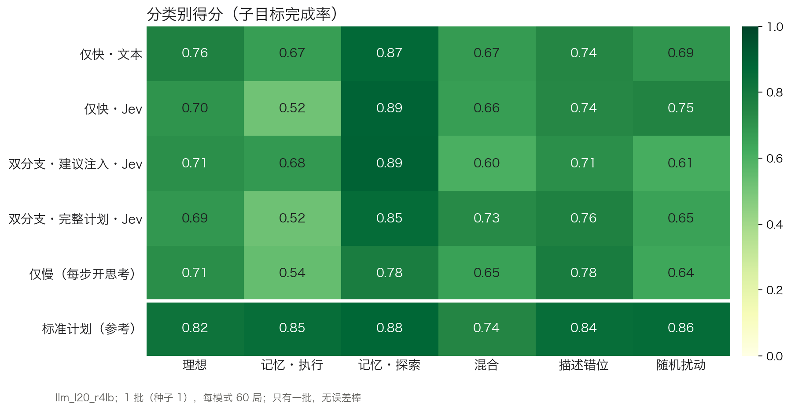
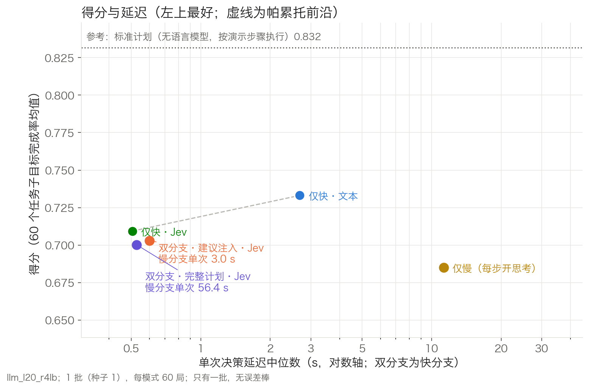
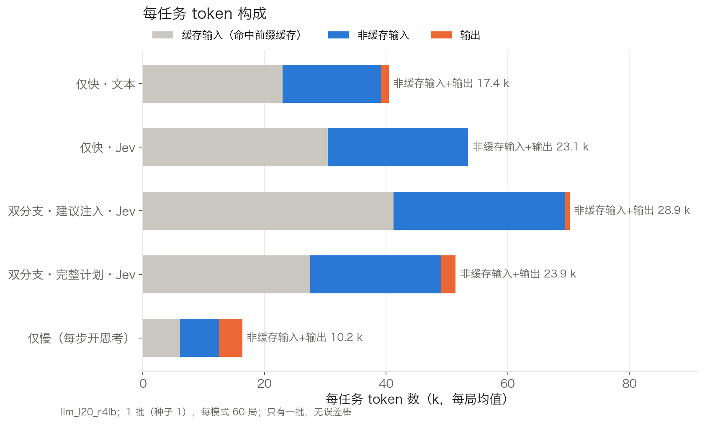
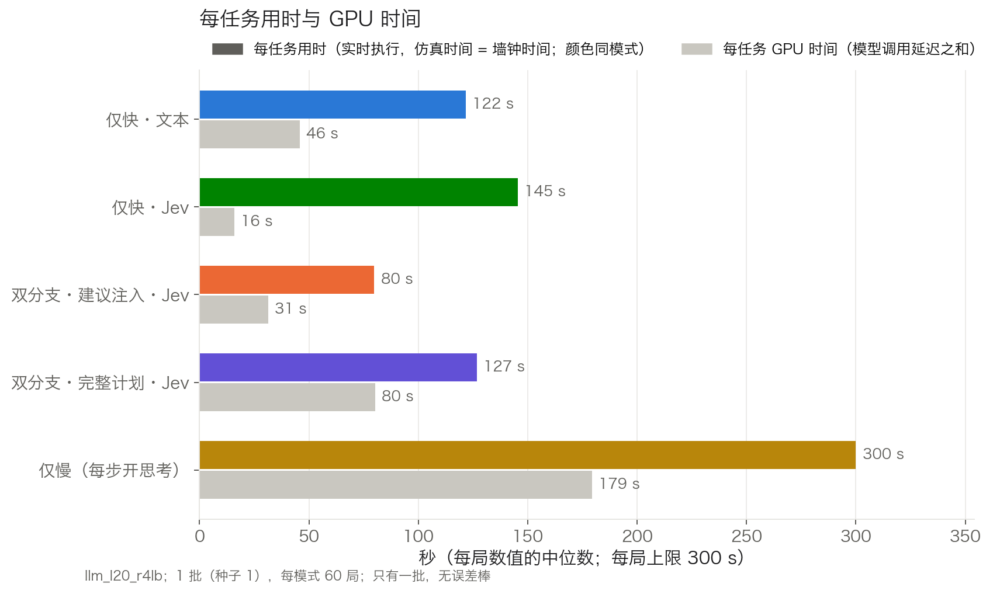

# RoboCerebra 60 任务排行榜：第一版（第 1 批，2026-10-22）

格式参考 VISTA（https://vista-benchmark.org/ ）：每行是一种推理模式，列为得分、整任务成功率、延迟、每任务用时、token 与 GPU 时间。本版只有第 1 批（种子 1，300 局），所以没有 ± 标准差；第 2、3 批正在运行。

## 1. 实验设置

- **模型**：Qwen3.8-27B，FP8 量化，L20 单卡，vLLM 0.27.1，开启前缀缓存。所有模式用同一个模型、同一个服务实例。
- **任务**：RoboCerebra 全部 60 个任务，分 6 类，每类 10 个。底层是 40 个任务文件，理想、描述错位、随机扰动三类共用同一批文件，只是运行条件不同。

  | 类别 | 运行条件 |
  |---|---|
  | 理想（Ideal） | 无动态事件 |
  | 记忆·执行（Memory_Execution） | 无动态事件，任务需要记住之前看到的物体位置 |
  | 记忆·探索（Memory_Exploration） | 无动态事件，目标物体在抽屉或柜子里，需要翻找 |
  | 随机扰动（Random_Disturbance） | 每进入一个新子步 0.5 s 后，把当前子步的相关物体（50%）或一个无关物体沿 y 方向平移 ±0.15 m |
  | 描述错位（Observation_Mismatching） | 开局状态取自人类演示第 2 个子步的开始时刻。第 1 个子步已经完成，但指令不变，模型需要自己发现；这部分子目标不计分 |
  | 混合（Mix） | 同时有随机扰动和描述错位 |

  动态条件按官方评测代码实现。我们是实时连续执行、做完一步就切换，官方则按固定时间片切换并逐段重置，因此有两点适配：扰动在当前子步变化时触发，位移相对物体当前位置。
- **执行**：
  - 实时运行，仿真 1 s 等于墙钟 1 s，控制频率 20 Hz。模型思考期间机器人和场景不会暂停。
  - 每局上限 300 s、40 次技能调用。
  - 语言模型只决定下一步调用哪个技能（共 15 个，如 pick、place、open_drawer）以及参数，动作由技能库执行。执行器在整个排行榜期间冻结（`exp_r4snap/`）。
- **实时性判据**：开局 3 s 之后最大滞后 ≤ 0.25 s，且滞后 p95 ≤ 50 ms。第 1 批 300 局全部满足。

### 五种模式

| 模式 | 做法 |
|---|---|
| 仅快·文本 | 关闭思考，每次决策直接生成一个 JSON 动作，如 `{"skill": "pick", "args": ["bowl_1"]}` |
| 仅快·Jev | 把当前所有合法的下一步动作列成带字母的候选项，模型只生成 1 个 token（选项字母），取对数概率最高者 |
| 仅慢（每步开思考） | 每次决策都先思考（上限 4096 token），再输出动作 |
| 双分支·完整计划·Jev | 快分支（Jev）不停做决策。慢分支在后台开思考，输出整段计划，快分支按计划执行；计划失效时慢分支重新规划 |
| 双分支·建议注入·Jev | 慢分支关闭思考，只输出不超过 2 句的建议，注入快分支上下文。在开局、技能失败、检测到循环、收到新消息时触发 |

两个双分支模式的快、慢分支共用同一个模型和同一段提示前缀，可以共享前缀的 KV 缓存。

## 2. 排行榜（第 1 批）

| # | 模式 | 得分 | 整任务成功 | 单次决策 p50 / p95 | 慢分支单次 | 每任务用时 | 每任务 token（非缓存输入+输出） | 缓存输入 | 每任务 GPU 时间 | 失败技能 |
|---|---|---|---|---|---|---|---|---|---|---|
| 1 | 仅快·文本 | 0.733 | 35%（21/60） | 2.68 / 3.80 s | – | 122 s | 15.4 k | 12.9 k | 46 s | 4 |
| 2 | 仅快·Jev | 0.709 | 33%（20/60） | 0.51 / 0.65 s | – | 145 s | 27.8 k | 34.5 k | 16 s | 18 |
| 3 | 双分支·建议注入·Jev | 0.703 | 42%（25/60） | 0.60 / 0.86 s | 3.0 s | 80 s | 20.7 k | 20.4 k | 31 s | 6 |
| 4 | 双分支·完整计划·Jev | 0.700 | 37%（22/60） | 0.53 / 0.70 s | 56.4 s | 127 s | 24.0 k | 20.8 k | 80 s | 16 |
| 5 | 仅慢（每步开思考） | 0.685 | 37%（22/60） | 11.26 / 54.87 s | – | 300 s | 10.9 k | 5.5 k | 179 s | 2 |
| – | 参考：标准计划（无语言模型，按演示步骤执行） | 0.832 | 40%（24/60） | – | – | – | – | – | – | – |

排名只按得分均值。单批数据下，前四名之间的差异不显著，见第 3 节。

**各列含义**
- **得分**：每个任务的子目标完成率，60 个任务取平均。
  - 子目标来自 RoboCerebra 的评分定义，按计分器 v6 计算。
  - 描述错位和混合类任务中，开局已完成的子目标同时从分子和分母扣除。
  - 失败或超时的局按实际完成的子目标计分。
- **整任务成功**：全部子目标都完成的局数占比。
- **单次决策 p50 / p95**：每次调用模型做决策的延迟（中位数 / 95 分位）。双分支模式取快分支，仅慢模式取每步开思考的调用。
- **慢分支单次**：双分支模式慢分支每次调用的延迟中位数。
- **每任务用时**：一局的时长（中位数）。全部完成、模型宣布完成、40 次技能用尽或 300 s 到时，最先发生者结束一局。
- **每任务 token**：与 VISTA 口径相同，为非缓存输入加输出，取每局中位数；缓存输入单独列出。
- **每任务 GPU 时间**：一局内所有模型调用的延迟之和（中位数）。模型是自部署的，用它代替 VISTA 的"成本"列。
- **失败技能**：一局内技能返回失败的次数（中位数），如抓取未成功、被上层抽屉挡住、抽屉未打开。不含格式无效的回复。
- **参考行**：用同一个执行器，按人类演示的子步顺序逐步调用技能，不使用语言模型，可以看作执行器能力的近似上限。它不是严格上限：标准计划不重试、不换目标位置，而每种模式都有 8–10 个任务的得分高于它。

## 3. 与仅快·Jev 的逐任务配对比较

双分支模式用的就是 Jev 快分支，所以以仅快·Jev 为基线。在同一任务上计算两种模式的得分差，再对 60 个任务取平均。95% 区间是按任务重抽样（bootstrap，10000 次）得到的；区间包含 0，表示差异不显著。

| 模式 | 得分差（均值） | 95% 区间 | 更好 / 相同 / 更差（任务数） |
|---|---|---|---|
| 仅快·文本 | +0.024 | [−0.030, +0.074] | 16 / 31 / 13 |
| 双分支·建议注入·Jev | −0.006 | [−0.067, +0.050] | 14 / 32 / 14 |
| 双分支·完整计划·Jev | −0.009 | [−0.064, +0.043] | 12 / 36 / 12 |
| 仅慢（每步开思考） | −0.024 | [−0.086, +0.035] | 17 / 23 / 20 |

## 4. 分类别得分

**怎么读**：每格是该模式在该类 10 个任务上的平均得分，末行为标准计划参考。每格只有 10 局，单格之间相差 0.1 以内不宜解读。

| 模式 | 理想 | 记忆·执行 | 记忆·探索 | 混合 | 描述错位 | 随机扰动 |
|---|---|---|---|---|---|---|
| 仅快·文本 | 0.762 | 0.667 | 0.866 | 0.672 | 0.740 | 0.692 |
| 仅快·Jev | 0.697 | 0.517 | 0.888 | 0.665 | 0.737 | 0.753 |
| 双分支·建议注入·Jev | 0.714 | 0.683 | 0.895 | 0.604 | 0.712 | 0.612 |
| 双分支·完整计划·Jev | 0.685 | 0.521 | 0.854 | 0.729 | 0.762 | 0.652 |
| 仅慢（每步开思考） | 0.715 | 0.543 | 0.781 | 0.653 | 0.783 | 0.636 |
| 标准计划（参考） | 0.823 | 0.847 | 0.875 | 0.744 | 0.844 | 0.855 |

## 5. 结束原因

| 模式 | 全部完成 | 宣布完成（未全部完成） | 40 次技能用尽 | 300 s 到时 |
|---|---|---|---|---|
| 仅快·文本 | 21 | 14 | 13 | 12 |
| 仅快·Jev | 20 | 4 | 24 | 12 |
| 双分支·建议注入·Jev | 25 | 13 | 15 | 7 |
| 双分支·完整计划·Jev | 22 | 6 | 19 | 13 |
| 仅慢（每步开思考） | 22 | 0 | 0 | 38 |

"宣布完成"有两种情况：快分支连续两次判定任务已完成，或完整计划执行完毕。表中这一列只统计宣布时还有子目标没有完成的局。所有模式都没有出现连续 5 次无效回复而中止的情况。

## 6. 图

### 得分与单次决策延迟

**怎么读**：
- 横轴是单次决策延迟中位数（对数轴），纵轴是得分，越靠左上越好。
- 虚线连接帕累托前沿上的模式，即没有别的模式比它更快且得分更高。
- 双分支模式标注了慢分支单次延迟。
- 顶部点线是标准计划参考。

### 每任务 token 构成

**怎么读**：
- 每条按缓存输入（灰）、非缓存输入（蓝）、输出（橙）分段，取每局均值，三段可以直接相加。
- 右侧数字是 VISTA 口径的 token 数。

### 每任务用时与 GPU 时间

**怎么读**：
- 彩色条是一局的时长；实时执行，所以仿真时间等于墙钟时间。
- 灰条是一局内模型调用延迟之和。两个分支同时调用时，延迟会重复计入。
- 两者都取中位数。

## 7. 主要结果

1. **五种模式得分在 0.685–0.733 之间，单批下差异不显著。** 与仅快·Jev 的逐任务差在 −0.024 到 +0.024 之间，95% 区间都包含 0。60 个任务中有 23–36 个得分完全相同，多为执行器可完成的子目标各模式都完成了，做不到的各模式都没做到。
2. **与标准计划的差距（0.10–0.15）主要在两类：**
   - 记忆·执行：0.52–0.68，参考值 0.85；
   - 随机扰动：0.61–0.75，参考值 0.86。

   记忆·探索类各模式为 0.78–0.90，与参考（0.88）持平。
3. **每步开思考受实时约束明显。**
   - 仅慢模式单次决策中位数 11.3 s，p95 54.9 s，每局中位数只做 8 次决策。
   - 60 局中 38 局用满 300 s；这 38 局平均得分 0.50，标准计划在相同任务上为 0.76。
4. **建议注入：整任务成功最多、用时最短、失败最少，但有提前宣布完成的问题。**
   - 整任务成功 25/60，为五种模式中最多；
   - 每任务用时中位数 80 s，为最短；
   - 失败技能中位数 6，仅快·Jev 为 18，完整计划为 16；
   - 慢分支单次 3.0 s，完整计划为 56.4 s；
   - 有 13 局在未全部完成时宣布完成，其中 7 局得分低于标准计划。
5. **Jev 快分支单次决策最快，但容易反复尝试失败的动作。**
   - 仅快·Jev 单次决策 0.51 s，仅快·文本为 2.68 s；
   - 失败技能中位数 18，60 局中 24 局用尽 40 次技能。
6. **仅快·文本得分均值最高（0.733），但存在提前结束。** 14 局在未全部完成时宣布完成，其中 10 局得分低于标准计划。
7. **Token：Jev 系列每任务非缓存 token 最多（20.7–27.8 k），仅快·文本为 15.4 k，原因有两个：**
   - 决策次数多，仅快·Jev 每局中位数 31.5 次，仅快·文本为 17.5 次；
   - 候选列表让提示更长，平均约 2,000 token，而每次只输出 1 个 token。

   各模式快分支提示的缓存命中率为 49–59%。vLLM 对该模型以 784 token 为一块缓存，提示末尾变化的部分（历史、当前状态、候选）不能复用。

## 8. 局限与说明

- 只有 1 批。第 2、3 批（种子 2、3，600 局）正在运行，预计 10-22 晚上完成，届时给出 ± 标准差并更新排名。
- 执行器已冻结，以下限制对所有模式相同：
  - 微波炉门和炉内放取未实现，影响约 16–20 个子目标；
  - 距底座 0.88–0.92 m 的物体够不到；
  - 平底锅放上灶台不稳定；
  - 部分倒入动作和杯子挂架不稳定。

  标准计划参考反映的就是这些限制。
- 随机扰动在混合 case1、case6 上大多被跳过（各模式合计 case1 执行 3 次、跳过 12 次；case6 执行 2 次、跳过 10 次）：可移动的桌面物体少，平移后会越出桌面或落到固定装置上。其余 18 个带扰动的任务都正常执行，每个任务各模式合计 2–43 次。
- 描述错位和混合类共 20 个任务，其中 13 个开局时机械臂手中已经拿着物体（演示中第 2 个子步开始时正拿着）。这一手持状态已同步给执行器，模型从观测中能看到手里拿着什么。

## 9. 数据与脚本

- 每局记录：`exp/runs/llm_l20_r4lb/<类别>_<case>/<模式>_s1/`（`episode.json`、`timeline.json`、`states.npz`）
- 统计：`exp/analyze_leaderboard.py --seeds=1`，输出 `notes/figs_lb/leaderboard_llm_l20_r4lb_s1.md` 和 `.json`
- 出图：`exp/plot_leaderboard.py --seeds=1`
- 标准计划参考：`exp/runs/gtplan_r4_final/`
